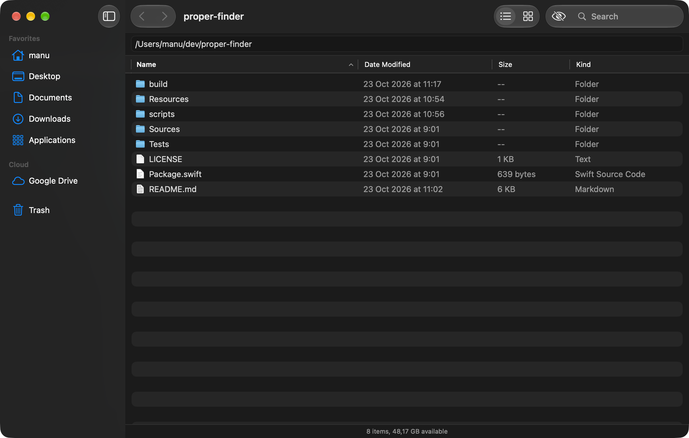
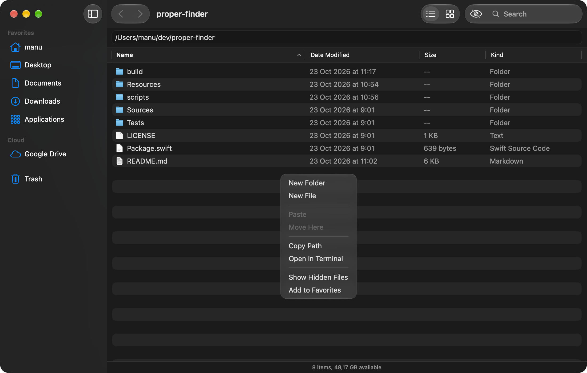
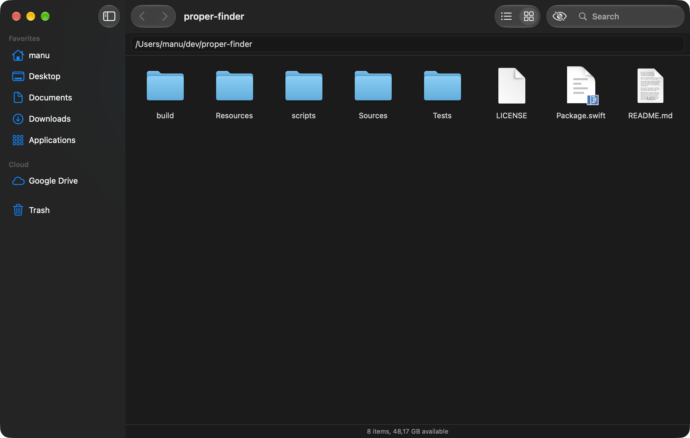

# ProperFinder

**A free and open-source file browser for macOS.**

ProperFinder is a simplified Finder with a few Dolphin-style extras: a plain address bar you can type or paste a path into, "Copy Path" everywhere, "New File" next to "New Folder", "Open in Terminal" and a hidden-files toggle in the toolbar. It is written from scratch in Swift (AppKit + SwiftUI), with native controls and no dependencies.



| Right-click: New File, Copy Path, Open in Terminal | Icon view |
|---|---|
|  |  |

## Features

- **Address bar**: the current folder's full POSIX path, always selectable and copyable. Type or paste a path and press Return: `~` works, a file path opens its folder with the file selected, an invalid path beeps and stays in the field. Escape restores it; ⌘L or ⌘⇧G focuses it.
- **Sidebar** like Finder's: Home, Desktop, Documents, Downloads, Applications and your own favorites (drop a folder on the section or use *Add to Favorites*, reorder by drag); **Cloud** (iCloud Drive and every `~/Library/CloudStorage` provider: Google Drive, OneDrive, Dropbox, Box…); **Locations** (mounted volumes, with an eject button); **Trash** with *Empty Trash*.
- **List view** (name, date modified, size, kind; sortable, folders first, multi-selection) and **icon view**.
- **New Folder / New File** (`untitled.txt`) that start an inline rename with the base name selected.
- **Context menus**: Open, Open With, Quick Look, Rename, Get Info, Copy, Copy Path, Add to Favorites, Move to Trash on items; New Folder, New File, Paste, Move Here, Copy Path, Get Info, Open in Terminal, Show Hidden Files, Add to Favorites on the background.
- **Copy / paste / move** never overwrite: a name collision keeps both, like Finder. Drag and drop moves on the same volume and copies across volumes.
- **Get Info** (⌘I): kind, size (folders counted in the background), location, creation and modification dates, all selectable.
- **Quick Look** with Space, **search** in the current folder (case and diacritic insensitive), **hidden files** with ⌘⇧., a status bar with the item count and free space.
- **Finder shortcuts**: ⌘[ ⌘] ⌘↑ ⌘↓ ⌘O, ⌘I, ⌘⇧N, ⌥⌘N, Return to rename, ⌘⌫, ⌘C, ⌘V, ⌥⌘V, ⌥⌘C, ⌘⇧H / D / O / A, ⌥⌘L, ⌘N for a new window. All are in the File, Edit, View and Go menus.
- The folder updates by itself when files change on disk.
- English and French.

## Install

Requires macOS 15 or later and a Swift 6 toolchain (Xcode, or just the Command Line Tools: `xcode-select --install`).

```bash
git clone https://github.com/manuelLandreau/ProperFinder.git
cd ProperFinder
./scripts/build-app.sh
open ~/Applications/ProperFinder.app
```

The build script signs the app with a local self-signed identity (kept in `.signing/`, never committed), so the folder and Full Disk Access grants survive rebuilds.

Launch options: `--root <path>` opens a given folder; `--ui-testing` uses a throwaway settings domain, no window restoration and no favorites.

## Testing

Three layers, from fast to black box:

```bash
./scripts/test.sh       # core + app tests (CI runs this)
./scripts/test-e2e.sh   # builds and installs the app, then drives it through the Accessibility API
```

- **Core** (`Tests/ProperFinderCoreTests`): every file operation on real temporary folders (unique names, rename validation, keep-both copy and move, moving a folder into itself, trash, path parsing, cloud and volume discovery, favorites, directory watcher). Assertions read the disk, not just return values.
- **App** (`Tests/ProperFinderAppTests`): drives `BrowserModel` the way the UI does (navigation, path field, copy path into a private pasteboard, new file/folder, rename, paste, drop, trash, hidden files, search, favorites, external changes), plus hosted-view tests that put the real window in an `NSHostingView` and walk its own accessibility tree. No permission needed. `PROPERFINDER_SNAPSHOT_DIR=/some/dir ./scripts/test.sh --filter HostedViewTests/snapshots` renders the main states to PNG for a visual check.
- **End-to-end** (`Tests/ProperFinderE2ETests`): launches `~/Applications/ProperFinder.app` (or `$PROPERFINDER_APP`) on a temporary fixture folder, clicks and types through the Accessibility API only, and checks the result on disk and in the pasteboard. It quits only the instance it launched.

The end-to-end tests need your terminal to be trusted for Accessibility: **System Settings › Privacy & Security › Accessibility**, add and enable your terminal app (Terminal, iTerm, Ghostty…), then restart it. Without it the suite fails with a message saying so. Note that these tests overwrite the clipboard and move one `properfinder-e2e-trash-me-….txt` file to your Trash.

## Good to know

- **Trash needs Full Disk Access.** macOS only lets apps with Full Disk Access list `~/.Trash`. Without it the Trash shows a button that opens the right System Settings pane. Moving items to the Trash works without it.
- **No "Put Back".** macOS has no public API to restore an item from the Trash; use Finder for that.
- **Google Drive** works through [Google Drive for desktop](https://www.google.com/drive/download/): it mounts your drive under `~/Library/CloudStorage/GoogleDrive-<account>`, which shows up in the Cloud section and is browsed like any folder. OneDrive, Dropbox and Box desktop apps work the same way.

## Contributing

Contributions are welcome — bug reports, ideas and pull requests alike. Please open an issue to discuss bigger changes first.

`Sources/ProperFinderCore` holds the file logic (Foundation only) and its tests; `Sources/ProperFinderApp` is the SwiftUI/AppKit interface; `Sources/ProperFinder` only starts it.

## License

[MIT](LICENSE). ProperFinder is an independent project, not affiliated with Apple.
